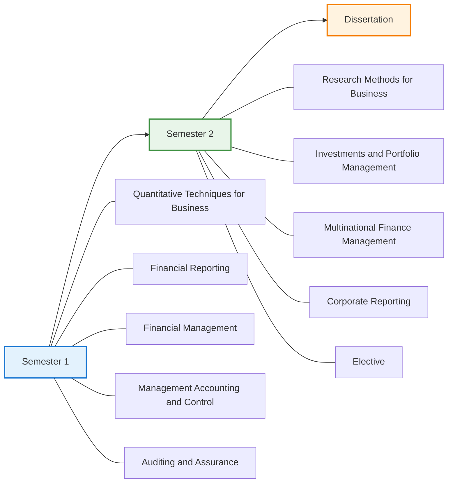
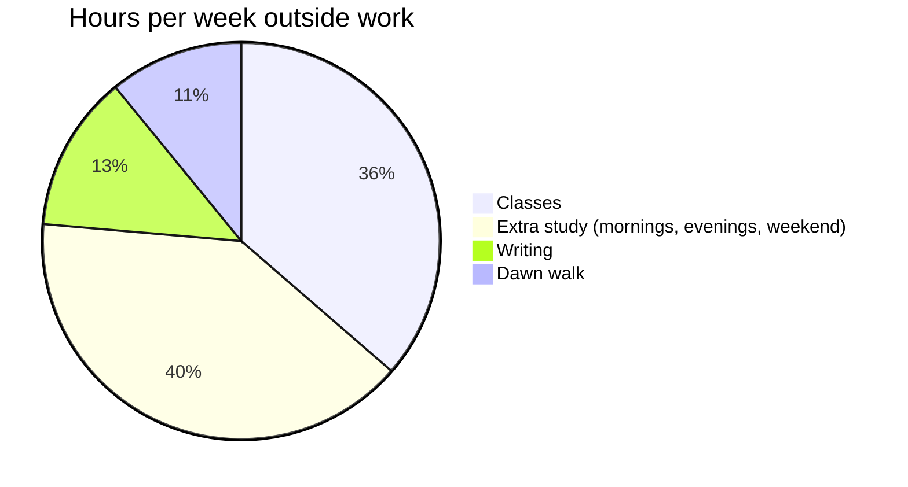
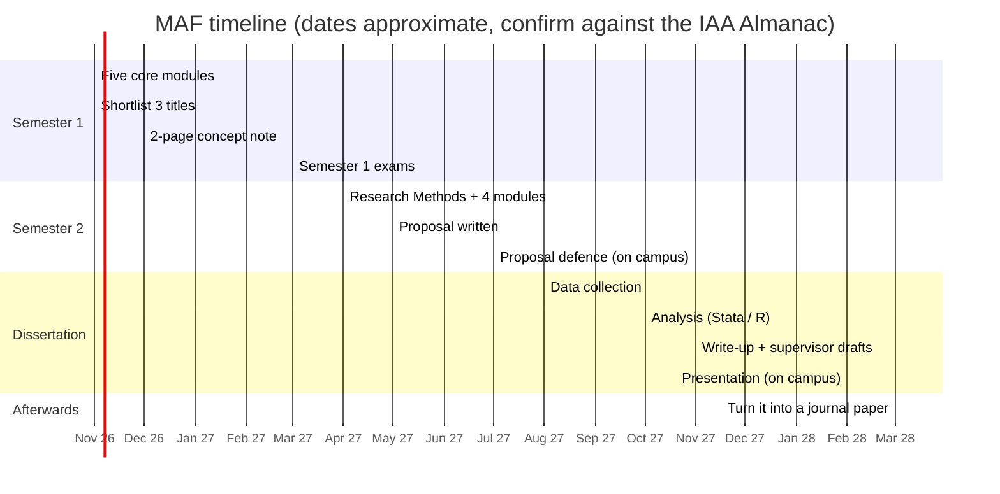
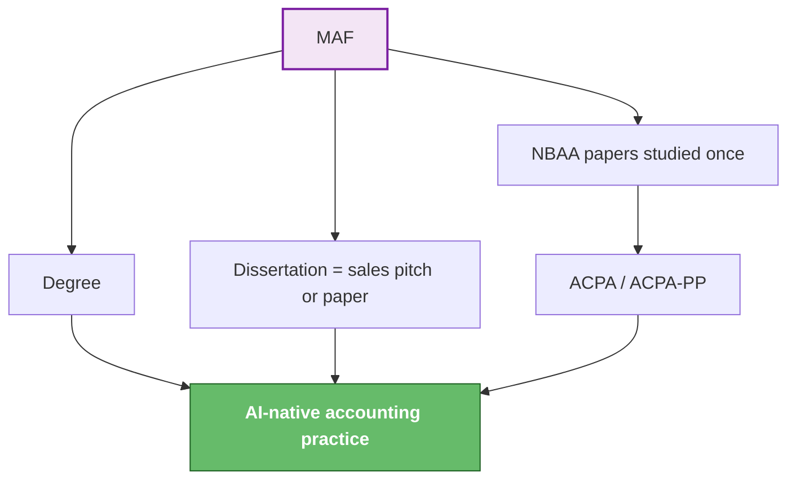

# 🎯 MASTER OF ACCOUNTING AND FINANCE — IAA
### Roadmap · study protocol · evening timetable · dissertation titles · extracurriculars · books and online

> [!important] Why the switch from MSc Finance & Economics
> The old roadmap aimed at the **practitioner-scholar** path: development economist, public finance, a PhD, World Bank consulting. [[00 Profile — The Memory]] says the actual business is **an AI-native accounting practice, with the accountant signing off**. The MAF is the degree that fits that business. Most of its modules are the same ground as the NBAA CPA(T) syllabus, so one block of study feeds **the degree, the ACPA credential and the practice** at once. The old file is kept, marked superseded: [[career_roadmap_strategy]].

---

## 1. The programme, as published

Source: [IAA — Master of Accounting and Finance](https://www.iaa.ac.tz/programmes/master-of-accounting-and-finance/3c5f29fd-b29e-4b5f-9225-a1836edb3b70)

| | |
|---|---|
| **Campuses** | Arusha · **Dar es Salaam** · Dodoma · Bukombe. Department of Accounting, Faculty of Finance and Accountancy |
| **Mode** | Full time, or **Blended Learning (BLM)**: classes and assignments on Moodle and Zoom. On campus for class tests, final exams, the proposal defence and the dissertation presentation |
| **Your slot** | Evening, **17:00 – ~19:00, every weekday** |
| **Intakes** | March and October |
| **Fee (Standard)** | **TZS 4,395,000**. The page doesn't say whether this is per year or for the whole programme. Ask the admissions office |

**Electives:** Management, Governance and Ethics · Behavioral Investments · Institutional Investments · Public Finance and Taxation · Advanced Taxation.

> [!danger] Five things to get from IAA, in writing, before paying
> 1. **Semester 1 start date** for the October 2026 intake. It's in the [2026/27 Almanac PDF](https://www.iaa.ac.tz/storage/app/public/524/6accafd8abbef_ALMANAC-FOR-THE-ACADEMIC-YEAR.pdf).
> 2. **Duration:** 18 months or 24, and when the dissertation is due.
> 3. **Fee:** per year or total, and the instalment dates. Put them in [[Expenses]] next to the school-fee dates.
> 4. **The coursework/exam split** per module, and the dissertation word limit.
> 5. **Accreditation of the Dar es Salaam campus for this programme.** A NACTVET registry page lists the DSM campus as "not accredited". It may be out of date or refer to other levels, but a master's from an unaccredited campus is the one thing that could make this whole plan worthless. Ask IAA and [NACTVET](https://www.nactvet.go.tz) directly.

---

## 2. The one-block, three-returns idea

Your MAF modules against the NBAA CPA(T) papers ([NBAA exam structure](https://www.nbaa.go.tz/pages/examination-structure)). This mapping is mine, not an official exemption. **No MAF exemption from NBAA papers was found.** Ask info@nbaa.go.tz.

| MAF module | NBAA paper it covers | What it gives the practice |
|---|---|---|
| Financial Reporting · Corporate Reporting | B2 Financial Accounting · **C1 Corporate Reporting** | IFRS statements clients will pay to have signed |
| Financial Management | B1 Financial Management · **C3 Business & Corporate Finance** | Cash-flow, valuation and funding advice |
| Management Accounting and Control | B5 Performance Management | Budgets, costing and KPI dashboards: the monthly-retainer product |
| Auditing and Assurance | B3 Auditing Principles · **C2 Audit & Assurance** | The ACPA-PP route, if you choose it (UNKNOWN #3) |
| Public Finance & Taxation / Advanced Taxation *(elective)* | B4 · **C4 Public Finance & Taxation II** | Tanzanian tax compliance: VAT, PAYE, TRA filings |
| Management, Governance and Ethics *(elective)* | B6 Management, Governance & Ethics | Engagement letters, AI-on-client-data consent |

> [!tip] Elective choice
> **Advanced Taxation** if you want the most saleable skill in Tanzania. **Public Finance and Taxation** if the dissertation is on CAG/LGA audits (see §5). Take *Behavioral Investments* only if you are heading towards fund management, which is not the plan.

---

## 3. The study protocol: ten rules

These keep the degree from becoming another apparatus ([[The Mentor Session — Seven Ideas]] §3: sustained effort, no exposure).

1. **Pre-read 20 minutes before class.** Skim the slides or chapter headings. You go into class with questions, not a blank page.
2. **One page of notes per class.** Cornell format: the main points, your questions, and a 3-line summary at the bottom. One page, not ten.
3. **Review within 24 hours.** Your next morning slot (§4) re-reads yesterday's page and turns it into 3–5 flashcards in [Anki](https://apps.ankiweb.net) (free on desktop and Android).
4. **One exam-style question a day.** From NBAA or ACCA past papers. Theory is not learned until it has been answered against a clock.
5. **Assignments start the day they're set,** with a first rough draft within 72 hours. The last week is for polishing, not starting.
6. **Saturday is for the long work:** assignments, the dissertation, the week's hardest topic.
7. **Sunday plans the week.** 30 minutes: what's due, which class is weakest, and one question to take to a lecturer.
8. **One lecturer conversation a fortnight.** Office hours, after class or an email. This is how you find a dissertation supervisor before you need one.
9. **A study group of 3, not 10.** One evening a week after class, or a Saturday call. Each person explains one topic to the other two.
10. **Hard stop at 21:30.** Blood pressure, sleep and work tomorrow come before an extra hour of reading. A tired 50-year-old brain stores nothing.

> [!warning] Exam season
> Six weeks before finals, switch the morning slot from new reading to past papers only, timed. Two weeks out, Saturday becomes a full mock exam.

---

## 4. The evening-course timetable

**Assumptions:** classes 17:00–19:00 Monday to Friday, and the dawn routine from [[The Rhythm — Daily, Monthly, Quarterly]] stays. The writing block moves to Tuesday and Thursday mornings and Sunday, so it is shrunk, not lost.

### Weekdays

| Time | Mon | Tue | Wed | Thu | Fri |
|---|---|---|---|---|---|
| 05:15–05:45 | Fajr + 20 min outside | Fajr + outside | Fajr + outside | Fajr + outside | Fajr + outside |
| 05:50–06:40 | **Study:** review + flashcards + 1 exam question | ✍️ Writing block | **Study:** review + flashcards + 1 question | ✍️ Writing block | **Study:** review + flashcards + 1 question |
| Workday | Work · leave at a fixed clock time | | | | |
| 16:30–16:50 | Pre-read for tonight's class | Pre-read | Pre-read | Pre-read | Pre-read |
| **17:00–19:00** | **CLASS** | **CLASS** | **CLASS** | **CLASS** | **CLASS** |
| 19:00–19:30 | Travel / Maghrib / eat | | | | |
| 19:45–20:30 | Write the one-page notes + flashcards | Notes | **Study group** | Notes | Light: Anki only |
| 21:00–21:30 | Five-line evening log, then screens off | Log | Log | Log | Log |
| 22:00 | Sleep | Sleep | Sleep | Sleep | Sleep |

Tuesday and Thursday mornings are writing, so on those days the 24-hour review happens in the 19:45 slot instead.

### Weekends

| Time | Saturday | Sunday |
|---|---|---|
| 07:00–08:00 | Walk (the long one) | Writing block (90 min, 07:00–08:30) |
| 08:30–12:30 | **Deep study:** assignment or dissertation (2 × 100 min, break between) | Family / rest |
| Afternoon | Free. Ṣalāt al-Tunjīnā in a Saturn hour, per [[The Rhythm — Daily, Monthly, Quarterly]] | 16:00–17:00 **Weekly review:** the week's flashcards, plus 30 min planning the next week |
| Evening | Free | Five-line log + the [[Expenses]] entry |

### Weekly load

About **21 hours of MAF per week**: 10 in class and 11 on your own. That's about what a master's needs to pass well without wrecking your health.

> [!note] Ramadan 2027 — starts around 8 February 2027 (confirm by moon sighting)
> Iftar in Dar is around 18:40, so it lands inside class. Ask early whether lecturers allow a break or a Zoom attendance for those weeks. Move the 05:50 study slot to straight after suhoor, and drop the 19:45 slot to Anki only. It also lands on [[Magha Rising]]'s loud February. Don't schedule exams-week heroics there.

---

## 5. Dissertation: possible titles

Pick by **data you can actually get**. Public data is safest for an evening student with a job.

| # | Working title | Data | Feasibility | Why it fits you |
|---|---|---|---|---|
| **1 ⭐** | **Determinants of audit opinions in Tanzanian Local Government Authorities: a panel study of CAG reports, 2015–2025** | Free CAG/NAOT reports, ~184 LGAs × 10 years | **High.** It's all public, quantitative, and no one has to agree to give you anything | Keeps the public-finance thread from the old plan, and the "Public Finance & Taxation" elective lines up with it |
| **2 ⭐** | **Adoption of AI and cloud accounting tools by accounting firms and SMEs in Dar es Salaam: drivers, barriers and effect on reporting quality** | Survey of 80–150 firms and SMEs | Medium: needs responses | **Directly feeds the practice.** The findings become your sales pitch, and the respondents become your first leads |
| 3 | Compliance with IFRS for SMEs among Tanzanian SMEs: does using an accountant matter? | Survey + financial statements | Medium | Builds on Msechu, Kasoga & Kipesha (2024), linked in §7 |
| 4 | Electronic Fiscal Devices and VAT compliance among Dar es Salaam retailers | Survey + TRA statistics | Medium | Pure Tanzanian tax: saleable skill |
| 5 | Accrual IPSAS adoption and financial-reporting quality in Tanzanian public entities | CAG reports + interviews | Medium-high | Public sector; pairs with title 1 |
| 6 | Capital structure and profitability of DSE-listed firms, 2014–2025 | Annual reports of ~25 listed firms | High, but a small sample | Classic finance; easy to supervise |
| 7 | Mobile money adoption and access to credit for women-owned SMEs | Survey / FinScope Tanzania data | Medium | Development angle; fundable later |
| 8 | Islamic banking windows in Tanzania: performance against conventional banks | BoT bank data + annual reports | Medium | Keeps the Islamic-finance thread alive, on a smaller scale |
| 9 | Corporate governance and financial performance of Tanzanian commercial banks | BoT + bank annual reports | High | Governance elective links |
| 10 | Determinants of late filing and tax penalties among small businesses: evidence from TRA data | TRA data (needs permission) | Low-medium | High value if TRA cooperates |

> [!tip] Recommendation
> **Choose between #1 and #2 by the end of Semester 1.** #1 is the safest path to a distinction and a publishable paper. #2 is weaker academically, but it's the one that makes money afterwards. Either way, write the 2-page concept note in the December clear window (9–14 Dec, [[The Rhythm — Daily, Monthly, Quarterly]]) and take it to a lecturer in January.

### Dissertation milestones

---

## 6. Extracurriculars: pick two, not five

Each one either puts you in front of people or gives you something to show them.

| What | How often | Why |
|---|---|---|
| **NBAA CPD seminars and the annual conference** (check [nbaa.go.tz](https://www.nbaa.go.tz) for dates) | Each quarter | CPD hours, and the room is full of ACPA/FCPA members who could be your **two referees** (Day 5 of [[ACPA(T) NBAA To-Do]]) |
| **One public post a month**, on LinkedIn or a blog: "What I learned about IFRS 16 this month", in plain Swahili or English | Monthly | This is exposure. It doubles as marketing for the practice and fills line 2 of the evening log |
| **Free SME bookkeeping clinic:** one Saturday afternoon a month, 2–3 small businesses | Monthly | Real cases for assignments, survey respondents for title #2, logbook-relevant experience (but check UNKNOWN #4 first) |
| **Toastmasters Dar es Salaam**, or present at IAA's research week | Fortnightly / once a year | The proposal defence and dissertation presentation are oral. Practise before they count |
| **A Kaggle or data project:** clean one DSE or CAG dataset in R or Stata | One project per semester | Builds the skills for title #1 or #6 before the dissertation starts |

---

## 7. Books, and stuff on the net

### Start with these five

| Book | For | Note |
|---|---|---|
| **Saunders, Lewis & Thornhill — _Research Methods for Business Students_** | Research Methods + the dissertation | The standard UK text. Buy the latest edition you can find, or a second-hand copy |
| **Brooks — _Introductory Econometrics for Finance_** | Quantitative Techniques | Finance examples throughout, with Stata/EViews/R companions |
| **Brealey, Myers & Allen — _Principles of Corporate Finance_** | Financial Management · Multinational Finance | The core finance textbook |
| **Elliott & Elliott — _Financial Accounting and Reporting_** | Financial Reporting · Corporate Reporting | IFRS-based, with UK/IFRS worked examples |
| **Drury — _Management and Cost Accounting_** | Management Accounting and Control | Clear, and full of exam-style questions |

### Then, by module

| Module | Book |
|---|---|
| Auditing and Assurance | Gray, Manson & Crawford — *The Audit Process*. Plus the free [IAASB Handbook (ISAs)](https://www.iaasb.org/publications) |
| Investments and Portfolio Management | Bodie, Kane & Marcus — *Investments* |
| Multinational Finance Management | Eiteman, Stonehill & Moffett — *Multinational Business Finance* |
| Behavioral Investments *(elective)* | Kahneman — *Thinking, Fast and Slow* · Shefrin — *Beyond Greed and Fear* |
| Taxation *(elective)* | The acts themselves, free from [TRA](https://www.tra.go.tz): Income Tax Act 2004, VAT Act 2014, Tax Administration Act 2015 |
| Governance and Ethics *(elective)* | Solomon — *Corporate Governance and Accountability* |
| Valuation (for the practice) | Damodaran — *The Little Book of Valuation* |

### Free online: courses, lectures, standards

| Resource | What it covers | Link |
|---|---|---|
| **OpenTuition**: free ACCA notes and lectures | The closest free match to your modules: **FR** (Financial Reporting), **FM** (Financial Management), **PM** (Management Accounting), **AA/AAA** (Auditing), **SBR** (Corporate Reporting), **AFM** (Multinational Finance), **ATX** (tax, UK-based) | [opentuition.com](https://opentuition.com) |
| **IFRS Foundation**: the standards themselves, free with a login | Financial and Corporate Reporting. Tanzania requires full IFRS for public companies and IFRS for SMEs for SMEs | [ifrs.org](https://www.ifrs.org) |
| **Aswath Damodaran (NYU Stern)**: full corporate finance and valuation classes, free on YouTube and his site | Financial Management · Valuation | [pages.stern.nyu.edu/~adamodar](https://pages.stern.nyu.edu/~adamodar/) |
| **MIT OCW 15.401 Finance Theory I** (Andrew Lo): videos, notes, problem sets | Financial Management · Investments | [ocw.mit.edu](https://ocw.mit.edu/courses/15-401-finance-theory-i-fall-2008) |
| **Yale, _Financial Markets_** (Robert Shiller), Coursera | Investments · Behavioral finance | [coursera.org](https://www.coursera.org/learn/financial-markets-global) |
| **Wharton, _Introduction to Financial Accounting_** (Brian Bushee), Coursera | A refresher on the basics before Semester 1 | search the title on Coursera |
| **Ben Lambert, econometrics** on YouTube | Quantitative Techniques: short, clear videos | search "Ben Lambert econometrics" |
| **_R for Data Science_**: a free online book | Dissertation analysis in R | [r4ds.hadley.nz](https://r4ds.hadley.nz) |
| **NBAA past papers and syllabi** | Daily exam questions (Protocol rule 4) | [nbaa.go.tz](https://www.nbaa.go.tz/announcements/nbaa-current-and-revised-syllabi) |

### For the dissertation: where to find papers and data

- **Papers:** [Google Scholar](https://scholar.google.com) · [AJOL, African Journals Online](https://www.ajol.info) · [SSRN](https://www.ssrn.com) · [DOAJ](https://doaj.org). Manage references with [Zotero](https://www.zotero.org), which is free. Install it on day one, not in month 14.
- **Tanzanian data:** [NAOT/CAG reports](https://www.nao.go.tz) · [Bank of Tanzania](https://www.bot.go.tz) · [TRA](https://www.tra.go.tz) · [NBS](https://www.nbs.go.tz) · [CMSA](https://www.cmsa.go.tz) · DSE annual reports via [africanfinancials.com](https://africanfinancials.com)
- **Papers to read first:**
  - Msechu, Kasoga & Kipesha (2024), on IFRS for SMEs compliance in Tanzania: [DOAJ](https://doaj.org/article/14a5802f40f54ec2ab7ed92af866ee7b)
  - Malima, Pillay & Obalade, *Tax compliance in an EFD-enabled environment*: [Business Perspectives](https://businessperspectives.org/journals/j-accounting-and-financial-control/issue-355/tax-compliance-in-an-efd-enabled-environment-evidence-from-a-developing-economy)
  - Lackson & Muba (2021), on IFRS for SMEs adoption in Mbeya: [EANSO](https://www.journals.eanso.org/index.php/eajbe/article/view/480)

---

## 8. Before Semester 1: the next six moves

| # | Move | When |
|---|---|---|
| 1 | Get the five answers in the box in §1, especially **accreditation** and the **start date** | This week (inside the 25–29 Oct window) |
| 2 | Log the fee and its instalments in [[Expenses]] next to the school fees | The same day |
| 3 | Install Zotero and Anki, and sign up for OpenTuition | One evening |
| 4 | Do the Wharton financial accounting refresher (about 4 weeks of evenings) | Before the first class |
| 5 | Buy or borrow Saunders and Brooks | Before the first class |
| 6 | Read the three MEMS fields (UNKNOWN #2). The MAF doesn't replace the ACPA, it runs alongside it | Any clear window |

---

## Related
[[00 Profile — The Memory]] · [[The Rhythm — Daily, Monthly, Quarterly]] · [[ACPA(T) NBAA To-Do]] · [[Expenses]] · [[Magha Rising]] · [[The Day Plan — 80-20, Pomodoro and Practice]] · [[career_roadmap_strategy]] *(superseded)*
