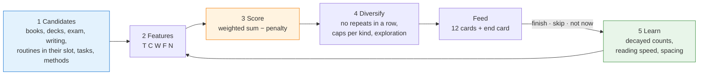

# 📲 Soma: the study feed

**Soma** ("read, study" in Swahili) borrows what makes TikTok and Reels hard to put down, and points it at your work. It's a full-screen swipe feed of what to do next: a reading chunk, a flashcard deck, one exam question, a writing sprint, the evening log. It learns from what you finish and what you put off, and it stops you at 21:30.

It works **fully offline**:

| Device | File | How to open it |
|---|---|---|
| 💻 Computer | `dist/soma.html` | Double-click it. Works in Chrome or Edge, no internet needed |
| 📱 Phone | `Soma-0.1.0.apk` (built from `android/`) | Copy to the phone, tap it, allow "install unknown apps" once |

### Sync: phone ↔ PC, no internet needed

**Your PC is the hub. Your phone syncs with it over the local network.** That can be the same Wi-Fi, or your phone's own hotspot with the PC connected to it, so it works with no internet at all.

**One-time setup:**
1. On the PC, double-click **Soma** (the desktop shortcut, or `Soma.cmd` in this folder). A small "Soma sync hub" window opens, and so does Soma in your browser.
   - The first time, **Windows Firewall asks about Node.js. Tick "Private networks" and click Allow.** Without that, the phone can't reach the PC.
2. In the browser: **Settings → Sync with your PC**. It shows your **PC address** (like `192.168.1.23:5178`) and a **6-digit sync code**.
3. On the phone: **Soma → Settings → Sync with your PC**. Type the address and the code, then tap **Sync now**.

After that it syncs by itself: when you open the app, 3 seconds after each block, and every 5 minutes. **Nothing is ever overwritten.** Reading done on the phone and exam questions done on the PC are added together, and XP caps apply to the combined day.

**What syncs, and how:**

| Data | Rule |
|---|---|
| Daily minutes, ticks and XP | Each device keeps its own count, and totals add them up, so nothing is counted twice |
| What the feed has learned ("not now", hidden cards, what you finish) | Combined from both devices' logs, so the feed learns from both |
| Books, flashcards, tasks, courses | The most recent change wins. Deleting a book deletes it on both |
| Notes and takeaways, badges | Everything from both |
| Settings | The most recent change wins, except feed order, the side filter and phone reminders, which stay per device |

**Obsidian:** while the hub runs, every sync also writes today's numbers into `01 Projects/Personal/Daily/YYYY-MM-DD.md`, including work done on the phone. It **adds** only what's new, so minutes from the `Write 25` / `Study 25` timers are kept.

**No Wi-Fi at all?** Use **Stats → Export backup** on one device, carry the file across (USB, Bluetooth, WhatsApp), and **Import backup** on the other. Importing **merges**; it never replaces.

**Starting over everywhere:** "Erase everything" only clears one device, and the PC's copy comes back on the next sync. To erase everything, close the hub window, delete `data/soma-sync.json`, then erase on each device.

> [!warning] The sync code protects your data on the local network
> Anyone on the same Wi-Fi who knows the code could read your Soma data. That's your study log: no passwords or money. Don't post a screenshot of the code. `data/` is gitignored, so it never goes to GitHub.

Related: [[The Game]] (same XP rules) · [[MAF]] · [[The Rhythm — Daily, Monthly, Quarterly]]

---

## What it borrows from short-video apps, and what it changes

| Feed mechanic | In Soma |
|---|---|
| Vertical swipe feed, one item per screen | One task per card, swiped up. Each card shows its reward (**+8 XP**) where a feed would show likes |
| A recommendation engine that learns | The ranking formula below, updated after every finish, skip and "not now" |
| "Not interested" | **Not now** (back in 2 hours, ranked lower for a day) and **Not for me** (method, watch and task cards only; your core work can't be hidden) |
| Autoplay | **Start** opens a full-screen focus timer. Leaving the app during a block counts as a *focus break*, and a block of 25+ minutes with none counts as a **deep block** 🧠 |
| Endless scroll | **Deliberately finite.** 12 cards, then an end card. Breaks after every 2 blocks, a daily focus limit (4 h by default), and **quiet hours, 21:30–05:00**, when the only card is "Hard stop" |
| Variable reward | After each block, **one of your own past notes comes back** ("From your notes, 3 Nov…") or a method insight. It's retrieval practice and a surprise in one. XP itself is never random |
| Streaks and levels | The same XP, levels (Mwanafunzi → Gwiji), weekly quests and boss fights as [[The Game]] |

## Techniques from the research, built in

- **Spaced repetition** (Ebbinghaus; Cepeda et al., 2006): flashcards are scheduled on an SM-2 style algorithm, so a deck appears in the feed when it's due.
- **Retrieval practice** (Roediger & Karpicke, 2006): after a reading block the app asks *"Close the book. One thing you remember"*, and you can turn it into a flashcard on the spot.
- **Interleaving** (Rohrer & Taylor, 2007): exam practice rotates to the module you've practised least lately.
- **The Pomodoro Technique and deep work** (Cirillo; Newport, 2016): timed blocks, deep-block counting, break cards and a shutdown at 21:30.
- **Stop mid-scene** (Hemingway): writing blocks end with *"Where did you stop? One line for tomorrow."*
- **21 method cards**, each with its source and an honest evidence label (*strong research* / *research* / *practitioner book* / *mixed*). They appear as exploration cards about once every five, earn no XP, and the ones you hide never come back.

---

## How the feed picks cards



### The score

**S = 0.30·T + 0.25·C + 0.20·W + 0.15·F + 0.10·N − penalty**

| Feature | Meaning | How it's computed |
|---|---|---|
| **T**: fits right now | Belongs to this time slot, or a deadline is near | 1.0 if the card's kind belongs to the current slot of your timetable (05:50 study Mon/Wed/Fri, writing Tue/Thu, 16:20 pre-read, 19:30 notes…), 0.15 if it doesn't, 0.45 in free time. Deadlines within 14 days push it up |
| **C**: you usually finish these | Predicted completion | (finished + 1) / (finished + put-off + 2). Finishing counts +1; "not now" −1; swiping past after a 3-second look −0.3. **An impression counts for nothing.** All counts halve every 14 days |
| **W**: importance | How much it matters | Exposure 1.0 (0.75 once you've had one this week), exam 0.85, writing 0.8, flashcards 0.7+, reading 0.55–0.85 by priority, methods 0.25. +0.15 when that side of your week is behind its target (150 min writing, 300 min study) |
| **F**: not done lately | Things you've neglected come back | 1 − e^(−days since last done / 2). Overdue flashcards are at least 0.5 |
| **N**: new to you | Novelty | 1 / (1 + times shown recently) |
| **penalty** | Explicit negative feedback | −0.25 per "not now" (fades within a day or two, max −0.5). −0.15 if you finished the same kind of work in the last 45 minutes |

Then the **re-rank**: each pick costs −0.08 if it's the same kind as the card before, −0.05 for the same topic, and −0.03 for a third card in a row from the same side. Each feed holds at most **1 watch card** (they need internet), **1 book-setup card** and **3 of any other kind**. **Two method cards** go in at positions 4 and 9 as the exploration budget.

Every card has a **"Why this card?"** button that shows its five numbers and the formula. Every weight is a slider in **Settings**.

> [!warning] Honest limits
> - This is a **weighted formula, not a trained AI model.** The features are kept separate from the scoring (`features()` vs `score()` in `src/engine.js`), so a learned ranker could replace it later.
> - **C favours what you already finish.** Without W and T it would drift toward easy work. That's why importance and time-fit carry 50% of the weight between them. If the feed starts feeling too comfortable, raise W.
> - **The weights are a starting guess,** not tuned on data. Use the "Is the feed working?" panel in Stats.

### Is it working? What to watch

Stats → **Is the feed working?** (last 14 days):
- **How useful (1–5)**: the main measure. Your own rating after each block.
- **Cards started then finished**: diagnostic only. High is not automatically good: it can mean the feed serves easy work.
- **Skipped, "not now", hidden**: rising numbers mean the ranking is wrong for you.
- **Kinds of work done** and **same card twice in a row**: diversity and repetition.

**Changing the formula:** change a weight → use it for a week → compare the usefulness rating and the mix of work in the panel. To change the code instead: edit `src/engine.js`, add a test that pins the new behaviour, then run `node --test test/`. The synthetic-user test there replays two weeks of habits, so you can check that a change still shifts the feed the right way.

---

## Getting the numbers into Obsidian

- **Stats → Copy** puts today's daily-note properties on the clipboard: `write_min`, `study_min`, `class`, `exam_q`, `walk`, `tablets`, `exposure`, `log`.
- **Stats → Save to Obsidian** *(desktop Chrome/Edge)*: pick the vault folder once. Soma then writes into `01 Projects/Personal/Daily/YYYY-MM-DD.md`, creating it from the Daily Note template if needed. It **adds** only what's new since the last save, so minutes from the desktop `Write 25` / `Study 25` timers are kept.
- **Library → Export notes as Markdown**: every takeaway, grouped by book, ready to drop into the vault.

## Build

```bash
node build.js            # src/ → dist/soma.html (and the Android asset)
node --test "test/*.test.js"   # engine, sync and hub tests
node sync-server.js --local --no-obsidian --data=%TEMP%soma-test   # a throwaway hub for testing
```

APK (needs the Android SDK and Android Studio's JDK, both on this machine):

```bash
cd android && JAVA_HOME="/c/Program Files/Android/Android Studio/jbr" "$USERPROFILE/.gradle/wrapper/dists/gradle-8.11.1-bin/bpt9gzteqjrbo1mjrsomdt32c/gradle-8.11.1/bin/gradle" --offline :app:assembleRelease
```

The output is `android/app/build/outputs/apk/release/app-release.apk`. It's **signed with the debug key.** That's fine for your own phone, but to install a later version over it, it has to be signed with the same key. Before you depend on it, make a release key as described in `android/app/build.gradle`.

## Files

| Path | What |
|---|---|
| `src/content.js` | **The data:** books, courses, timetable slots, routines, the 21 methods, levels, bosses, reminders. Edit this to change what's seeded |
| `src/engine.js` | Candidates, features, score, diversify, learning, XP. No DOM, so it's testable in Node |
| `src/app.js` · `styles.css` · `index.html` | The interface |
| `test/engine.test.js` | The unit tests and the synthetic two-week user |
| `test/sync.test.js` · `test/hub.test.js` | Merging two devices and the hub; the hub over real HTTP, including the code checks and the Obsidian writer |
| `sync-server.js` · `Soma.cmd` | The PC sync hub, and its double-click launcher |
| `data/` | The hub's combined copy and the sync code. **Personal, gitignored** |
| `android/` | WebView wrapper: reminders (AlarmManager), timer alert, keep-screen-on, saving to Download/Soma |

## Not done yet: don't assume otherwise

- **No real phone has run it yet.** It was tested in a desktop browser, and on the Android 16 emulator: install, feed, swipe, timer, leaving mid-block, the back button, and the reminders switch. All 7 reminders were scheduled at the right times as exact alarms. **What wasn't seen:** a notification actually appearing (none came due during the test), and reminders coming back after a reboot.
- **Exact alarms rely on `USE_EXACT_ALARM`.** Android grants it at install to a sideloaded app, but Google Play would refuse it. If a phone ever withholds it, Soma falls back to inexact alarms, which can arrive minutes late.
- **No sync between phone and computer.** That's by design (offline), so use the backup file. Two devices used on the same day will each have their own numbers.
- **No PDF or e-book reader inside the app.** You read the real book, and Soma times it and asks what you remember.
- **Exam questions aren't bundled.** The card tells you which module; the question comes from NBAA or ACCA past papers.
- **The book page counts aren't filled in.** Each book asks for its count the first time it appears, rather than taking one I'd have to guess.
