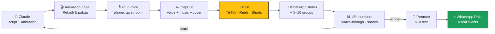
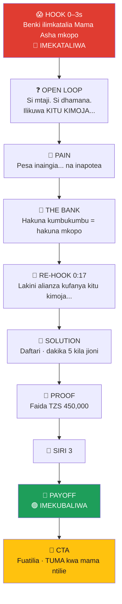
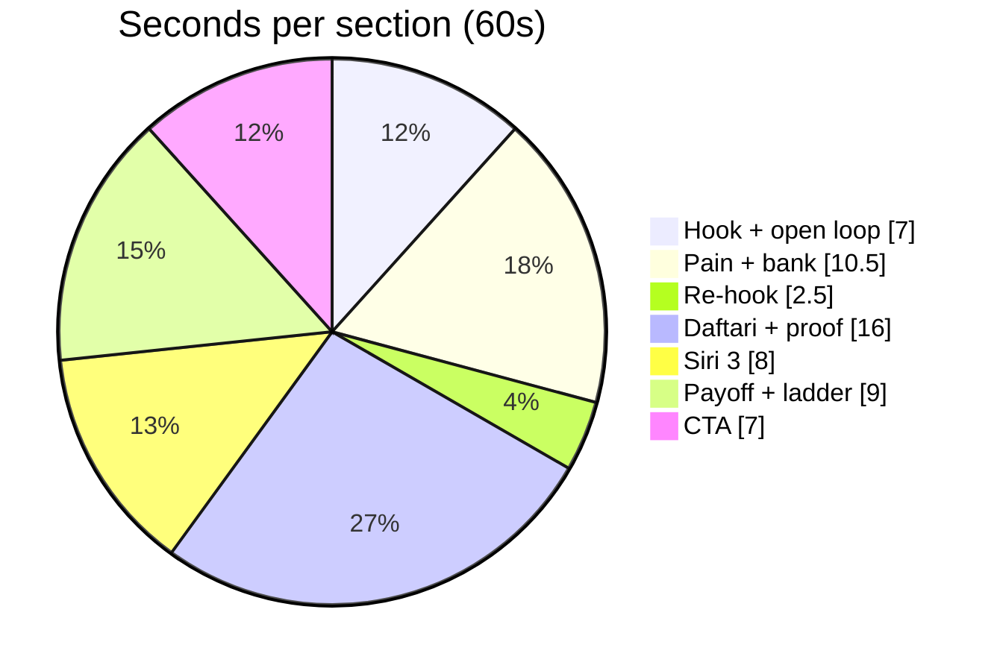
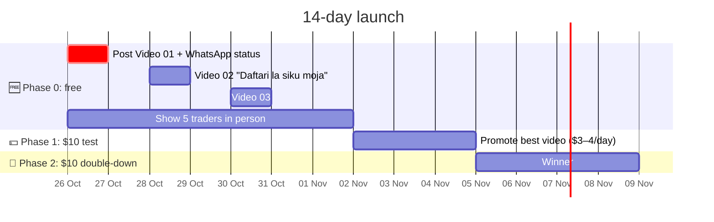
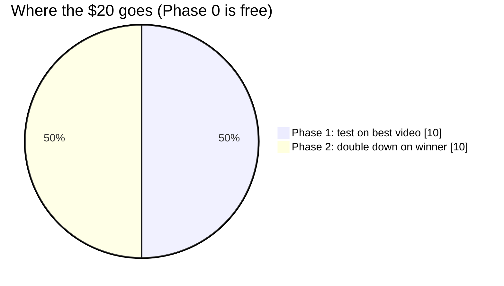
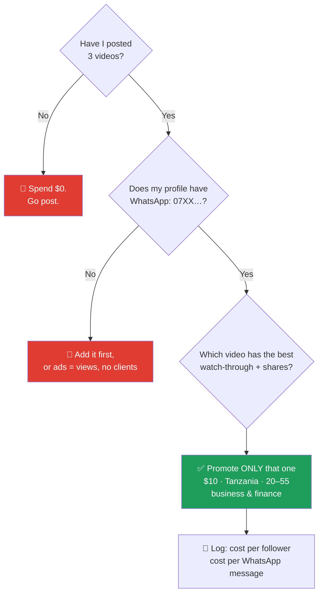
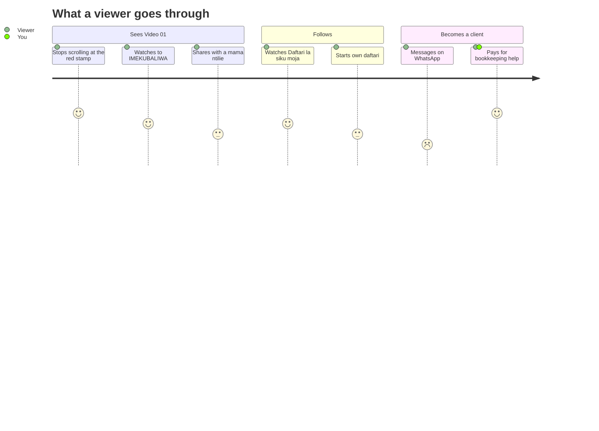

# 📒 Hesabu Rahisi — Faceless Channel Playbook

> [!quote] The whole strategy in one line
> **Teach Tanzanian small traders to keep records → they trust you → some become bookkeeping clients.**
> Followers are the bait. **Clients are the fish.** 🐟

![[unsplash-mzizima-market.jpg|700]]
*Mzizima Fish Market, Dar es Salaam: this is your audience. Photo: [Nichika Sakurai](https://unsplash.com/@nichiyoshi) / Unsplash.*

> [!danger] 🚨 Read this before anything else
> Videos posted: **`= this.videos_posted`**. If that number is 0, close this note and go post.
> Building this note earned **0 XP**. Posting the video earns the `exposure` points. *What went in front of someone who can say no?*

---

## 🧭 1. The decisions already made

| Question | Decision | Why |
|---|---|---|
| Which niche? | **Swahili record-keeping and loans for small traders** | Low competition, and every viewer is a possible client. English personal finance is crowded and its viewers aren't your market |
| Which tools? | **Claude (scripts + animation code) + your own voice + CapCut (free)** | AI video generators are expensive and bad at showing numbers accurately |
| Fully AI voice? | **No, use your voice** | Builds trust, and YouTube demonetises "inauthentic" mass-produced AI content |
| One video or two? | **One**: before → help → after, in a single story | Splitting it kills the payoff |
| Which thumbnail? | **Version A: red IMEKATALIWA stamp** | Conflict stops the scroll. B gives away the ending |
| Pay for followers? | **Never buy followers.** Promote only a proven video | Bots kill your reach |

---

## 🏭 2. The content machine



---

## 🎬 3. Video 01: *"Benki ilimkatalia Mama Asha"* (bank refuses Mama Asha)

**Files:** [[Video 01 — Script]] · `Video 01 — Mama Asha (animation).html` (open in Chrome or Edge → **⏺ Rekodi & pakua video**)

### The story arc



### Every scene (real frames from the video)

| Hook | Open loop | Pain | Bank |
|:-:|:-:|:-:|:-:|
| ![[frame-01-hook.jpg\|150]] | ![[frame-02-sababu.jpg\|150]] | ![[frame-03-story.jpg\|150]] | ![[frame-04-benki.jpg\|150]] |
| **Re-hook** | **Daftari** | **Proof** | **Siri 3** |
| ![[frame-05-rehook.jpg\|150]] | ![[frame-06-daftari.jpg\|150]] | ![[frame-07-mwezi.jpg\|150]] | ![[frame-08-siri.jpg\|150]] |
| **Payoff** | **Ladder** | **CTA** | |
| ![[frame-09-kubaliwa.jpg\|150]] | ![[frame-10-ngazi.jpg\|150]] | ![[frame-11-cta.jpg\|150]] | |

### Where the 60 seconds go



### The marketing techniques (and where each one sits)

| 🧲 Technique | 📍 Where | 🧠 Why it works |
|---|---|---|
| Conflict in 2 seconds | Red stamp, screen shake | People stop for a problem, not a lesson |
| Open loop | "angalia hadi mwisho" | The brain hates an unanswered question |
| Relatable hero | Mama Asha: kilemba, kitenge | Viewers see themselves |
| Re-hook at 0:17 | "Lakini…" | The point where most viewers leave |
| Tiny-effort promise | "Dakika 5 tu" | Removes "sina muda" |
| Specific numbers | TZS 450,000 | Numbers feel true |
| Curiosity word | "SIRI 3" | Promises hidden knowledge |
| Payoff | 🟢 IMEKUBALIWA | Before → after closure |
| Share CTA | "TUMA kwa mama ntilie" | Shares spread further than likes |
| Cliffhanger | "Kesho: daftari la siku moja" | A reason to follow |

> [!warning] ⚖️ Honesty rules (non-negotiable)
> - Mama Asha is **fictional**. The video says "Hadithi ya mfano" (an example story). Never present her as a real client.
> - Audited accounts are the **top** of the ladder, not step one. Never promise anyone a loan.
> - It's education, not personal tax or loan advice. Check NBAA rules while you're still training. → [[Career Leverage]]

---

## 🎙️ 4. Narration, ready to read

`/` = short pause · `//` = long pause · **bold** = hit it hard

> **(0:00)** Benki ilimkatalia **Mama Asha** mkopo. //
> **(0:03)** Si kwa sababu ya mtaji. / Si dhamana. / Ilikuwa **kitu kimoja** — angalia hadi mwisho. //
> **(0:07)** Mama Asha anauza chakula **kila siku**. / Pesa inaingia… / na **inapotea**. //
> **(0:12)** Benki ilimuuliza: / "Unauza kiasi gani kwa mwezi?" / Hakujua. // **Hakuna kumbukumbu — hakuna mkopo.** //
> **(0:17)** Lakini… / alianza kufanya **kitu kimoja kidogo**. //
> **(0:20)** Daftari. / Kila jioni, **dakika tano tu**: / anaandika mauzo, / anaandika matumizi. / Mauzo toa matumizi — / hiyo ndiyo **faida**. //
> **(0:29)** Mwisho wa mwezi, anajua ukweli: / mauzo **milioni moja, laki tatu na elfu hamsini**. / Faida — **laki nne na elfu hamsini**. //
> **(0:36)** **Siri tatu**: / Moja — andika kila siku. / Mbili — tenganisha pesa ya biashara na ya nyumbani. / Tatu — pitisha pesa benki au kwenye simu. Inakuwa ushahidi. //
> **(0:44)** Miezi sita baadaye… // **Imekubaliwa!** //
> **(0:48)** Biashara ikikua, / hesabu rasmi na zilizokaguliwa / zinafungua **mikopo mikubwa zaidi**. //
> **(0:53)** Wewe ndiye **Mama Asha** anayefuata? / **Fuatilia** — / na **tuma video hii** kwa mama ntilie unayemjua. / Kesho: daftari la siku moja.

> [!tip] 🎤 Recording tips
> Quiet room · phone one hand-width from your mouth · **record the first line 3 times, keep the most energetic one** · smile on the last line, because a smile can be heard.

---

## #️⃣ 5. Caption + hashtags

> Benki ilimkatalia Mama Asha mkopo… sababu ni moja tu 📒
> Angalia hadi mwisho, kisha mtumie mama ntilie au boda boda unayemjua 👇
> *Hadithi ya mfano. Elimu ya biashara, si ushauri binafsi wa mkopo.*

| Platform | Hashtags |
|---|---|
| 📸 Instagram (3–5) | `#biashara #mamantilie #mkopo #wajasiriamali #Tanzania` |
| 🎵 TikTok (4–6) | `#biashara #mkopo #mamantilie #bodaboda #tiktoktanzania #elimuyafedha` |
| ▶️ YouTube Shorts | `#biashara #mkopo #Shorts` |
| 🔄 Spares to rotate | `#kumbukumbu #mtaji #bongo #daressalaam #biasharandogo #fedha #wanawakenabiashara #hesabu` |

---

## 🖼️ 6. Thumbnail (ChatGPT)

**Pick version A**, the red stamp. Keep B for a later video.

![[unsplash-fruit-cart-vendor.jpg|420]]
*Scene reference example. Photo: Ali Mkumbwa / [Unsplash](https://unsplash.com/photos/NXC0nTfrW8I).*

> [!caution] 📷 Real photos = reference only
> Attach an Unsplash photo **only for the setting, light and mood**. Never put a real, recognisable woman under "BENKI ILIMKATALIA". That says something false about a real person. Tell ChatGPT to create a **new, fictional** woman.

> [!example]- 🅰️ Prompt A: realistic, "rejected" (click to expand)
> ```
> Use the attached photo ONLY as a reference for setting, lighting, camera angle and atmosphere. Do NOT copy the person in it. Create a NEW, fictional woman who does not resemble anyone in the photo.
>
> Create a vertical TikTok cover, 9:16 (1080×1920), photorealistic, like a real smartphone photo taken in Dar es Salaam, natural warm afternoon light, shallow depth of field.
>
> SUBJECT: a fictional Tanzanian "mama ntilie" (street food vendor), about 40, dark-brown skin, bright orange kilemba headwrap, magenta kitenge dress with yellow and turquoise patterns. She stands at her food stall beside a large steaming aluminium pot (sufuria) and plates of rice and beans. She holds a small exercise notebook and looks straight into the camera with a worried, shocked expression, hand on her cheek. Face large and sharp in the upper-middle of the frame. Background softly blurred: busy street, boda bodas, colourful shop signs (no readable text).
>
> GRAPHIC OVERLAY:
> - Top third, huge bold white sans-serif text with thick black outline:
>   Line 1: BENKI ILIMKATALIA
>   Line 2 (bright yellow #FFC20E): MAMA ASHA MKOPO
> - Middle-right, big red rubber stamp, tilted -10°: IMEKATALIWA
> - Thin kanga-style border of small triangles in yellow, turquoise, magenta and orange.
>
> RULES: Spell every Swahili word exactly. No other text. Keep the bottom 20% and right edge clear (TikTok buttons). Dignified, respectful portrayal of a hard-working businesswoman, not poverty imagery. No logos, no watermarks, no bank names.
> ```

> [!example]- 🅱️ Prompt B: "after" (for a later video)
> ```
> Same fictional woman, same stall, lighting and angle. Now she is smiling proudly, holding the notebook up to the camera. Replace the red stamp with a green stamp: IMEKUBALIWA
> Top text: Line 1 "SIRI 1 ILIYOMPA" / Line 2 (yellow) "MAMA ASHA MKOPO". Spell exactly; no other text.
> ```

> [!example]- 🔧 If ChatGPT gets the spelling wrong
> ```
> Keep the image exactly the same, but fix the text. It must read exactly: "BENKI ILIMKATALIA" / "MAMA ASHA MKOPO" and the stamp "IMEKATALIWA". Change nothing else.
> ```
> Still wrong after 2 tries? Generate it **with no text** and add the words in CapCut or Canva.

> [!tip] 🥇 Better than AI
> Photograph a **real** mama ntilie near you, with her permission and a small thank-you, and make her the hero of a **success** video, never the rejected one. Nobody can copy that.

---

## 💸 7. The $20 campaign (≈ TZS 50,000; check today's rate)

![[unsplash-dar-street-traffic.jpg|700]]
*Dar es Salaam traffic. Photo: Emma Kapicha / [Unsplash](https://unsplash.com/photos/lcrK3P_S2c0).*





### Should I spend money today?



| ✅ Known | ❓ Unknown: test it |
|---|---|
| Never buy followers: bots kill reach and break TikTok rules | Is TikTok **Promote** available in Tanzania? Check: video → ⋯ → Promote |
| Paying boosts what works; it doesn't fix a weak video | Will your card or mobile-money virtual card work? Test with $1–2 first |
| Clients pay, followers don't | Real cost per follower in TZ: your test will tell you |

> [!info] 🤔 Opinion (not fact)
> Many Tanzanian traders over 30 live on **Facebook and WhatsApp** more than TikTok. A Facebook boost of the same video might be cheaper per client. Let the test decide.

---

## 🗓️ 8. The series



| # | Video | Status |
|---|---|---|
| 01 | Benki ilimkatalia Mama Asha | 🟡 Built, **not posted** |
| 02 | Daftari la siku moja (promised in 01!) | ⏳ Build after 01 is live |
| 03 | Tenganisha pesa ya biashara na ya nyumbani | 💭 Idea |
| 04 | Benki zinaangalia nini? | 💭 Idea |
| W1 | **Wewe Ltd 01**: Mshahara 2.5M, unapokea 1.29M (Gen Z / city / debt series) → [[Wewe Ltd 01 — Script]] | 🟡 Built, post **after** 01 and 02 |

---

## 📊 9. Scoreboard (fill in after each post)

| Date | Video | Views | Watched past 3s | Shares | Follows | WhatsApp DMs | TZS spent |
|---|---|---|---|---|---|---|---|
| 2026-10-26 | 01 | | | | | | 0 |

> [!success] 🎮 The Game
> Each post → set `exposure` in today's daily note. Each message from a real trader is worth more than 1,000 views.

---

## 🧱 Boss fight

- [ ] 🔥 **Post Video 01 tonight before 21:30** (voice + CapCut + cover A)
- [ ] Share on WhatsApp status + 3 groups
- [ ] Show it to 5 traders in person: *"Ungeelewa hii?"*
- [ ] Add WhatsApp contact to the TikTok bio
- [ ] Check numbers after 48 hours → tell Claude → build Video 02

![[unsplash-dar-city.jpg|700]]
*Dar es Salaam. Photo: Samson Tarimo / [Unsplash](https://unsplash.com/photos/pxeA-AaEcCA).*

---

## 🔗 Links & sources

- Related: [[Career Leverage]] (the bookkeeping track) · [[00 The Board]]
- Photos (all under the [Unsplash License](https://unsplash.com/license)): [Mzizima Market, Nichika Sakurai](https://unsplash.com/photos/a-crowd-of-people-standing-around-a-street-vendor-7PcZ2UonkIw) · [Fruit cart, Ali Mkumbwa](https://unsplash.com/photos/NXC0nTfrW8I) · [Street traffic, Emma Kapicha](https://unsplash.com/photos/lcrK3P_S2c0) · [City, Samson Tarimo](https://unsplash.com/photos/pxeA-AaEcCA)
- Video frames: rendered from `Video 01 — Mama Asha (animation).html`
