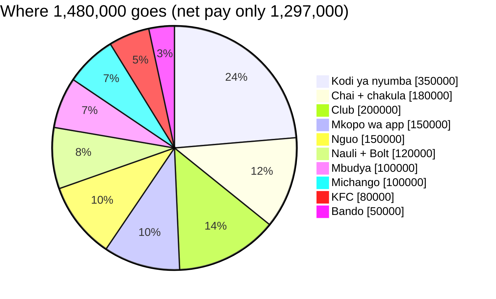

# 💼 Wewe Ltd 01: "Mshahara 2.5M, unapokea 1.29M"

**Video file:** `Wewe Ltd 01 — (animation).html` (open in Chrome or Edge → **⏺ Rekodi & pakua video**). Neon night-city look, amapiano beat built in.
**Series idea:** *your job is a business.* Salary is revenue, life is expenses, and most young city workers are running a company that makes a loss.
Hub: [[Hesabu Rahisi — Faceless Channel Playbook]]

> [!warning] Order matters
> Video 01 (Mama Asha) promises *"Kesho: daftari la siku moja"*. Post Video 01, then keep that promise, then post this one. It's a **second series**, not a replacement.

---

## 🧾 The numbers (checked)

| Item | Rate | TZS | Basis |
|---|---|---|---|
| Gross salary | | **2,500,000** | example |
| NSSF (employee) | 10% of gross | −250,000 | my knowledge, check with HR |
| Taxable pay | gross − NSSF | 2,250,000 | NSSF is deducted before PAYE |
| PAYE | 128,000 + 30% over 1,000,000 | −503,000 | [RSM Tanzania Tax Guide 2025/26](https://www.rsm.global/tanzania/sites/default/files/media/documents/RSMTZ_Tanzania%20Tax%20Guide%202025-26.pdf) |
| HESLB student loan | 15% | −375,000 | [The Citizen](https://www.thecitizen.co.tz/tanzania/news/national/how-15pc-deductions-helped-heslb-double-loan-recovery-2588942). Sources differ on gross vs basic; same here (no allowances) |
| NHIF | 3% employee share | −75,000 | my knowledge, check with HR |
| **Total deductions** | **48.1%** | **−1,203,000** | |
| **Net pay** | | **1,297,000** | |

> [!info] Watch for changes
> An MP has asked the government to revise HESLB deductions ([The Citizen](https://www.thecitizen.co.tz/tanzania/news/national/mp-asks-govt-to-revise-heslb-loan-deductions--2655378)). Re-check the rate before reposting this in a later year.

### The month (example, my assumptions)

| Result | TZS |
|---|---|
| Net pay − expenses | **−183,000 (loss)** |
| After 3 cuts (club 200→80, clothes 150→50, KFC 80→40) | **+77,000** |
| After the app loan is paid off | **+227,000 / month** |

---

## 🎙️ Narration (67s)

`/` short pause · `//` long pause · **bold** = hit it

| Time | On screen | Say |
|---|---|---|
| 0:00 | 2,500,000 crossed out, counting down to 1,297,000 | **Mshahara milioni mbili na nusu.** / Lakini unapokea… // **milioni moja, laki mbili na elfu tisini na saba.** |
| 0:03 | Phone: bank SMS | Ijumaa asubuhi, SMS inaingia… / subiri. // **Si nililipwa milioni mbili na nusu?** |
| 0:07 | Payslip, cuts one by one | Hati ya mshahara. / NSSF — **laki mbili na nusu**. / Kodi ya mapato — **laki tano na elfu tatu**. / Bodi ya Mikopo — **laki tatu sabini na tano**. / NHIF — elfu sabini na tano. |
| 0:16 | 48% donut | **Asilimia arobaini na nane** imeenda — // **kabla hujaigusa.** |
| 0:19 | WEWE LTD card | Sasa fikiria hivi: / wewe si mfanyakazi tu. // **Wewe ni kampuni.** |
| 0:23 | Expenses tick down, balance turns red | Kodi ya nyumba. / Nauli na Bolt. / Chai, chakula. / Bando. / Nguo mpya. / KFC Mlimani City. / **Club Ijumaa na Jumamosi.** / Mbudya. / Michango ya harusi. / Na… mkopo wa app. // Salio limeisha — **na ni tarehe kumi na nane.** |
| 0:37 | Income statement + HASARA stamp | Taarifa ya mapato ya kampuni yako: / **hasara ya laki moja themanini na tatu elfu.** // Kampuni hii **ingefilisika.** |
| 0:43 | Debt-trap loop | Na mwezi ujao? / Hasara. / Mkopo wa app. / Riba. / Hasara kubwa zaidi. // **Mtego wa madeni.** / Unamjua mtu yuko hapa? |
| 0:49 | Three cuts, red → green | **Usiache starehe — ipange.** / Club, elfu themanini. / Nguo, elfu hamsini. / KFC, elfu arobaini. // Hasara inageuka **faida: elfu sabini na saba** kila mwezi. / Mkopo wa app ukiisha — **laki mbili ishirini na saba.** |
| 1:00 | CTA | Una madeni? / Bajeti haieleweki? // **Comment "BAJETI"** tukusaidie kupanga. / Tag rafiki wa club ya Ijumaa — / na fuatilia kwa sehemu ya pili. |

---

## 🧲 Why it holds attention

| Technique | Where |
|---|---|
| A shock number in second 1 | 2.5M crossed out, counting down to 1.29M |
| "That's me" moment | Bank SMS on a phone on Friday morning |
| Real document | A payslip, cut line by line with a register "snip" |
| Reframe | "Wewe ni KAMPUNI": your life as a business |
| City life they live | KFC Mlimani City, club, Mbudya, michango |
| Conflict + stamp | **HASARA**, "ingefilisika" |
| Fear without shame | Debt-trap loop, "unamjua mtu yuko hapa?" (someone *else*, so nobody feels attacked) |
| Fun-friendly fix | "Usiache starehe. IPANGE." Cut, don't quit |
| Comment keyword CTA | "BAJETI": comments push reach **and** give you leads to DM |
| Tag CTA | "Tag rafiki wa club ya Ijumaa": free distribution |

---

## #️⃣ Caption + hashtags

> Mshahara 2.5M… unapokea 1.29M 😳 Kisha club, KFC, Mbudya… na tarehe 18 salio limeisha. Wewe ni kampuni — inapata faida au hasara? Comment "BAJETI" 👇
> *Namba ni mfano. Elimu ya fedha, si ushauri wa uwekezaji.*

| Platform | Hashtags |
|---|---|
| TikTok | `#mshahara #bajeti #genztanzania #daressalaam #madeni #fedha` |
| Instagram | `#mshahara #bajeti #daressalaam #madeni #fedha` |
| Shorts | `#mshahara #bajeti #Shorts` |

---

## ⚖️ Before you sell "financial advisory"

- **Budgeting and debt coaching = education. Fine.** Telling people which shares, funds or investments to buy is **regulated investment advice**. I believe it needs a licence from the CMSA (Capital Markets and Securities Authority); check before you offer it. Stay with budgets, debt plans and bookkeeping.
- **Debt audience = vulnerable audience.** Never shame anyone, never promise "out of debt fast", never recommend another loan to clear a loan.
- **"Comment BAJETI" is a promise.** Only post it when you can reply to every comment within 24 hours. A lead you ignore is worse than no lead.
