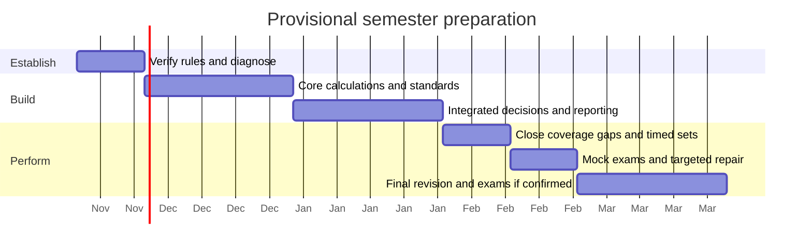
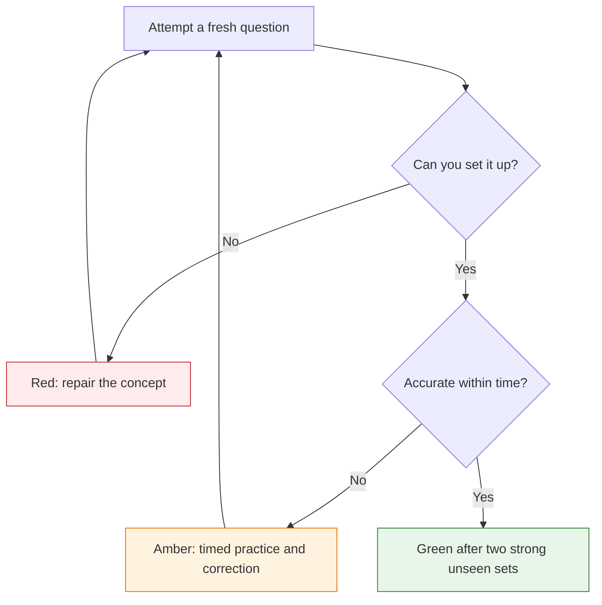

# 🎯 Semester One Strategic Study Roadmap
> **17 November 2026 → March 2027 | Financial Management • Financial Reporting • Performance Management**
>
> Build the skill, secure coursework marks, then practise delivering under exam conditions.

## 🧭 Start here

| Open this section when… | Go to |
|---|---|
| You want the assessment rules and uncertainties | [Marks and evidence](#-marks-and-evidence) |
| You want to know what the guides put in exams or coursework | [Financial Reporting](#-financial-reporting-the-clearest-assessment-map), [Financial Management](#-financial-management-decisions-backed-by-numbers), [Performance Management](#-performance-management-costs-decisions-and-control) |
| You need this week's work | [Roadmap](#-roadmap-to-march-2027) |
| You need questions to ask lecturers | [Clarification checklist](#-questions-to-ask-your-lecturers-now) |
| You need to turn studying into completed work | [Weekly execution](#-weekly-execution-and-progress-board) |

> [!important] What this plan can establish
> The attached documents show **planned assessment coverage**, not what actually appeared in past exams. No past papers or marking schemes were supplied. **No document gives fixed exam percentages for individual topics.** Practice questions, priorities and deadlines below are recommendations, not leaked questions or official allocations.

> [!note] Planning assumption
> **March 2027 is your provisional semester-end target.** No official exam timetable appears in these documents. The roadmap runs through 31 March as a planning boundary; move the final revision phase to the actual exam dates once confirmed. These documents name MA/MAF programmes, although your folder says MSc Finance and Economics. Confirm that all three modules apply to your registration.

## 💰 Marks and evidence

| Module | Credits in guide | Coursework | Semester exam | Confidence and action |
|---|---:|---:|---:|---|
| Financial Management | 10 | 50% | 50% | Stated consistently in §§4.4–4.5; guide labelled 2026/2027. Topic grid has gaps/conflicts. |
| Financial Reporting | 15 | 50% | 50% | Competence-grid headers and integrated assessment agree. Year/code/template errors mean current applicability needs confirmation. |
| Performance Management | 15 | 50% in introduction/breakdown | 50% in introduction/breakdown | **Conflict:** competence grid says CA 40% / exam 60%. Ask lecturer which applies. |

**CA = continuous assessment**, which can contain tests, assignments and other activities. **SE = semester examination.** A CA tick alone does not identify a test or assignment.

### Performance Management's detailed breakdown

| Component | Percentage of whole module stated in §4.4 |
|---|---:|
| Individual assignment | 15% |
| Group assignment | 15% |
| Progress tests, combined | 20% |
| Final exam | 50% |
| Total | 100% |

The same section states minimums of **25/50 coursework**, **25/50 final exam**, and **50/100 overall**. These are from an older guide and need confirmation. Its methods section mentions at least three classroom tests of at least two hours; **that does not establish your present timetable or equal marks per test**. FM and FR do not supply comparable assignment/test percentage breakdowns.

> [!warning] Resolve these before relying on the map
> - PM Word guide labels itself **2021/2022** and contains the same 50/50 versus 40/60 conflict as the earlier PDF.
> - FR allocation guide says **2026–2026**, mixes ACG09102/AFG09102 and includes copied Public Finance and Taxation text.
> - FM §3 explicitly lists WACC for tests, assignments and exam, but §4.2 leaves its SE cell blank.
> - FR syllabus mixes explicit IFRS 15/16 references with older lease/construction-contract wording. Ask which treatment/version the lecturer will assess.

### Plan marks without guessing topic weights

If 50/50 is confirmed: **module total = 0.5 × coursework percentage + 0.5 × exam percentage**.

| Illustrative coursework result | Illustrative exam result | Module total |
|---:|---:|---:|
| 70% | 60% | 65% |
| 80% | 60% | 70% |
| 60% | 80% | 70% |

**Personal target:** 70%+ in coursework and timed practice, then improve weak areas. This is a study target, not an official grade boundary. Do not let assignments consume all your time; do not postpone them until exam revision either.

## 🔵 Financial Reporting the clearest assessment map

**Source: FR allocation guide §4.2.** Legend: **✅** tick present; **—** no tick. A dash means “not marked here”, not “guaranteed excluded”. The mapping needs lecturer confirmation, especially for integrated questions.

### A. Topics specifically marked for the semester exam

| ID | Topic | CA | SE | What to be able to do | Practice question to ask yourself |
|---|---|:---:|:---:|---|---|
| FR1 | Accounting theory applied to information systems | — | ✅ | Connect information needs, accounting concepts and system design | How would a poor system undermine reliable financial information, and what controls would I propose? |
| FR2 | Capital maintenance concepts | — | ✅ | Distinguish concepts and explain their effect on reported profit | Would different capital-maintenance assumptions produce different distributable profit? Explain with a small example. |
| FR3 | IFRS 2 share-based payments | — | ✅ | Work lecturer-covered recognition, measurement and journal-entry cases | How do the scheme's conditions affect the expense and corresponding entry? |
| FR4 | IFRS 8 operating segments | — | ✅ | Identify segments, apply the taught reportability rules and prepare disclosures | Which activities should be separately reported, and what information is missing? |
| FR5 | IAS 10 events after reporting date | — | ✅ | Distinguish adjusting/non-adjusting events and explain treatment | Does the event provide evidence about conditions at year-end or arise afterwards? |
| FR6 | IAS 37 provisions and contingencies | — | ✅ | Classify obligations; measure provisions; distinguish recognition/disclosure | Is there a present obligation, and what treatment follows from the facts? |
| FR7 | IFRS 5 held-for-sale/discontinued operations | — | ✅ | Assess classification, measurement and presentation | Does management's disposal plan meet the taught criteria, and how does presentation change? |
| FR8 | IAS 21 foreign transactions/entities | — | ✅ | Apply exchange rates, calculate differences and explain presentation | Which rate applies at initial recognition and reporting date, and where does the difference go? |

**Practice target per row:** one concise rule sheet, three unseen cases, one timed written explanation. These quantities are recommendations. For FR1–FR2 use short structured arguments; for FR3–FR8 include calculations/entries where appropriate.

### B. Topics marked for coursework

**The document does not split these topics between tests and assignments. Prepare both:** solve under time pressure, and produce a researched worked case.

| ID | Topic | CA | SE | What to learn and do | Concrete output |
|---|---|:---:|:---:|---|---|
| FR9 | Conceptual framework | ✅ | — | Reporting objectives, qualities, elements, accrual/cash bases, regulation, limitations and fair presentation | One framework map and a 500-word application to a reporting problem |
| FR10 | IAS 16 PPE | ✅ | — | Recognition, cost, depreciation, revaluation, disposal and disclosures | Asset roll-forward plus entries for three adjustments |
| FR11 | IAS 38 intangible assets | ✅ | — | Recognition, research/development, subsequent treatment and distinction from goodwill | Classify five expenditures; calculate carrying amounts |
| FR12 | IAS 36 impairment; IAS 2 inventories | ✅ | — | Identify impairment indicators and measure loss; apply inventory valuation | One impairment case and one inventory write-down case |
| FR13 | IAS 24 related parties | ✅ | — | Identify relationships/transactions and required disclosures | Related-party register and draft disclosure note |
| FR14 | IAS 19 employee benefits | ✅ | — | Apply lecturer-covered benefit recognition and measurement | One benefit schedule and supporting entries |
| FR15 | IFRS 16 leases | ✅ | — | Classify the arrangement; work lessee/lessor treatments taught in class | Lease schedule, balances and journal entries |
| FR16 | IFRS 15 revenue | ✅ | — | Analyse customer contracts and recognise revenue using the required treatment | Three contract cases with calculations and reasons |
| FR17 | IFRS 9 financial instruments | ✅ | — | Classification, initial/subsequent measurement, interest and presentation | Instrument classification table and measurement schedule |
| FR18 | IAS 12 income taxes | ✅ | — | Current/deferred tax, tax bases and temporary differences | Tax schedule reconciled to journal entries |
| FR19 | IFRS 6 exploration expenditure | ✅ | — | Apply the lecturer's required exploration/expenditure treatments | One expenditure classification and measurement case |

### C. Coverage that needs a direct ruling

| Topic | Evidence in your documents | What to ask / prepare meanwhile |
|---|---|---|
| Specialised entities | Allocation guide lists it, but neither CA nor SE is ticked | Which entities and standards? Obtain one worked example. |
| Complete financial statements and analysis | Detailed FR syllabus Topic 3 | Will there be a trial-balance question, cash flows, ratios or extracts? Practise one integrated statement case. |
| Basic/diluted EPS; bonus/rights issues, splits, convertible debt and options | Detailed syllabus Topic 4 | Is EPS assessed in CA, SE or both? Build one weighted-average-share schedule and one dilution case. |
| Policies, estimates and errors | Detailed syllabus Topic 4 | What corrections and comparative treatments must we demonstrate? Classify six cases. |
| Borrowing costs and government grants | Detailed syllabus Topic 2 | Which numerical/disclosure treatments are required? Work one case of each. |
| Consolidation: subsidiaries, associates, joint ventures | Syllabus overview only; not clearly allocated in the detailed grid | Is group accounting actually included this semester? If yes, obtain the exact scope before allocating major study time. |
| Ethics and IFRS/IPSAS scope | Ethics in overview; public/private framework comparison in Topic 3 | What depth and assessment form? Prepare a short standards-choice/ethical-pressure case. |

> [!tip] Your FR strategy
> Prepare **both streams every week**. Prioritise exam-ticked topics for timed SE practice, while keeping asset, lease, revenue, tax and instrument skills active for coursework and possible integrated questions. **Do not infer that a standard cannot appear in an exam because its SE box is empty.**

## 🟠 Financial Management decisions backed by numbers

**Source: FM §3, Topic Detail Framework and §4.2.** Here **Explicit** means the document names that assessment method. It does not guarantee a question or fixed marks.

| ID | Topic and required coverage | Exam evidence | Test evidence | Assignment evidence | Practice question and output |
|---|---|---|---|---|---|
| FM1 | Objectives, stakeholders, agency and corporate decisions | Named in topic framework; SE ticks in grid | Not individually named for this topic | Named in framework | Why might a manager choose a project shareholders would reject? Write a one-page recommendation with governance measures. |
| FM2 | Budgeting, trend/regression/scenario forecasts, working-capital and capital-expenditure needs | Explicit §3 | Explicit §3 | Explicit §3 | How much additional finance is needed if sales rise but collections slow? Build a linked forecast with three scenarios. |
| FM3 | Short-, medium-, long-term finance; cost, control, flexibility, availability and statement effects | Explicit §3 | Explicit §3 | Explicit §3 | Which funding source fits the asset's life and cash flows? Compare three alternatives, quantify costs and recommend. |
| FM4 | Individual funding costs, WACC, financing mix, debt implications and sensitivity | Explicit §3; **SE cell blank in §4.2** | Explicit §3 | Explicit §3 | What happens to WACC and project value when the funding mix changes? Solve five cases and state assumptions. |
| FM5 | Capital structure theories, operating/financial gearing, debt risk and shareholder value | Explicit §3 | Explicit §3 | Explicit §3 | Can cheaper debt increase overall risk? Calculate gearing and defend a capital-structure choice. |
| FM6 | Dividend policies, earnings/retention, competing theories, peer comparison and Tanzania factors | Explicit §3 | Explicit §3 | Explicit §3 | Should a cash-constrained growth firm maintain its dividend? Write a balanced case answer with supporting figures. |
| FM7 | Time value, project cash flows, NPV/IRR/payback, tax, depreciation and risk | Explicit §3 | Explicit §3 | Explicit §3 | Two methods rank projects differently: which decision do you recommend and why? Build a full appraisal with sensitivity analysis. |
| FM8 | Working-capital policies, profitability/liquidity and funding requirements | Named in framework and grid | Not individually named | Named in framework | Can a profitable firm run short of cash? Calculate the funding gap and propose collection/inventory/payment changes. |
| FM9 | Mergers/acquisitions, growth alternatives, funding and valuation | Named in topic framework; absent from detailed competence grid | Not individually named | Named in framework | Does the acquisition create value after its purchase price and financing costs? Prepare a valuation and a short recommendation. |

**FM4 is not safe to skip for the exam.** Its narrative matrix explicitly includes SE and its calculations support other topics. FM9's precise assessment scope and the per-task meaning of compressed tick groups need clarification.

### FM practice sequence

1. **Discounting and cash-flow logic:** solve present/future-value and appraisal questions by hand before checking Excel.
2. **Cost of capital and funding:** calculate, interpret and state assumptions; avoid treating a formula as the full answer.
3. **Budgets and liquidity:** link assumptions to cash needs; explain why profit and cash differ.
4. **Theory and recommendations:** compare alternatives using the facts of the case, then make a choice.
5. **Integrated case:** forecast → choose finance → estimate funding cost → appraise investment → assess liquidity and risk.

**Completion test:** two fresh integrated questions with correct workings and a defensible recommendation; record your score rather than simply checking “read”.

## 🟣 Performance Management costs decisions and control

**Source: PM learning tables and assessment-plan competence grid.** All five broad outcome groups have CA and SE ticks. Some detailed teaching-table method cells are blank or inherited from a group heading; these do not establish exclusive test/assignment allocations.

### A. What the teaching table explicitly names

| Area | Semester exam | Class tests | Assignment | Evidence limit |
|---|---|---|---|---|
| Accounting overview/users | Named | Named | Not named on that row | Detailed teaching table |
| Decision process, changing environment, customer satisfaction, management-accounting functions | Not individually named on those assignment rows | Not individually named | Named | Broad cost-accounting outcome remains CA/SE assessed |
| Cost terms and cost estimation | Named | Named | Named in some repeated rows | Duplicated teaching rows vary; cover all three |
| Cost assignment/accumulation; ABC and alternative profit measurement | Named at group heading | Named at group heading | Not specified for each subtopic | Broad grid confirms CA/SE; blank subrows are not exclusions |
| CVP and decision-making group | Named at group heading | Named at group heading | Not specified for each subtopic | Relevant costing, pricing and risk subrows do not each repeat a method |
| Budgetary planning/control | Named | Named | Named | Group heading |
| Performance measurement/control | Named | Named | Named | Group heading |
| Standard costing/variances | Named | Named | Named | Group heading |

### B. Comprehensive practice map

| ID | Learn this | Questions you should be asking | Work to produce |
|---|---|---|---|
| PM1 | Accounting purposes/users; decision process; competition, customer satisfaction and management-accounting functions | Who needs this information? How does it change a decision? What does the changing environment make obsolete? | One service-organisation case explaining information needs and system improvements |
| PM2 | Cost objects; direct/indirect, product/period, fixed/variable, sunk/opportunity/incremental costs | Relevant for which decision and time horizon? Which cost changes if I choose differently? | Classify 20 items and defend the difficult classifications |
| PM3 | High-low, scattergraph, least squares/multiple regression, reliability, correlation and learning curves | Is the cost relationship credible within this range? Am I calculating average or incremental learning hours? | Four estimation problems and a learning-curve case with interpretation |
| PM4 | Blanket/departmental overheads, two-stage allocation, under/over-recovery, service/non-manufacturing costs and ABC | Is the driver causing the cost? Does the allocation distort a product's profitability? | One overhead analysis and an ABC-versus-traditional comparison |
| PM5 | Absorption/variable profit measurement; denominator levels; target, life-cycle, kaizen and back-flush costing | Why do profits differ? When is the cost committed? Which method fits the production environment? | Profit reconciliation plus a comparison of costing methods with examples |
| PM6 | Break-even, contribution/PV ratio, margin of safety, charts, multi-product mix and operating leverage | What assumptions make the result valid? What if sales mix or fixed cost changes? | Five CVP cases, including multi-product analysis and a labelled chart |
| PM7 | Relevant materials/labour; special orders; make/buy; closure; replacement; constraints and throughput | What changes in cash flows? What is forgone? Which resource is actually limiting output? | Five decision cases with qualitative factors and recommendations |
| PM8 | Cost-plus and short/long-run pricing; customer profitability; optimal price using calculus | Is the firm a price setter or taker? Is mark-up confused with margin? What does the customer cost to serve? | Four pricing/profitability cases including one optimisation problem |
| PM9 | Expected values; standard deviation/coefficient of variation; trees; perfect/imperfect information; maximin/maximax/regret and diversification | Are probabilities known? Which choice fits the stated attitude to risk? What is information worth? | A decision tree, a payoff/regret table and an information-value case |
| PM10 | Sales/production/materials/labour/overhead/cash/master budgets; incremental, activity-based and zero-based budgeting; behaviour | Do all budgets reconcile? Does the target encourage slack or manipulation? What changes in a nonprofit? | Linked master budget and a one-page behavioural critique |
| PM11 | Feedback/feed-forward controls; responsibility centres; controllability; participation; contingency and harmful incentives | Is this manager responsible for the measured outcome? Could the measure reward poor decisions? | Design a control system and identify three unintended behaviours |
| PM12 | Divisional profit; ROI, residual income, EVA; assets/depreciation; transfer prices; balanced scorecard; VFM and IT support | Can ROI discourage a worthwhile investment? What transfer price aligns incentives? Are service outcomes measured? | Divisional calculation case and a scorecard with objectives, measures, targets and initiatives |
| PM13 | Standard costs; material/labour/variable and fixed overhead/sales variances; capacity/efficiency; mix/yield; planning/operating; profit reconciliation; investigation; ABC links | Is the variance caused by price, quantity, mix or a changed plan? Does “favourable” mean good overall performance? | Five variance sets, one complete profit reconciliation and an investigation memo |

**Useful personal application:** build a fictional health-service example for VFM, budgets and balanced scorecard. Use invented or public data for practice. Your aim is to connect the calculation to a management decision.

## 🗓️ Roadmap to March 2027

**Proposed work windows, not official teaching dates.** Start from your actual knowledge: use diagnostics to shorten mastered material and protect time for weak prerequisites. Each fortnight revisits older topics; it is not a one-pass reading schedule.

| Window | Financial Management | Financial Reporting | Performance Management | Milestone |
|---|---|---|---|---|
| 17–30 Nov | FM1; discounting diagnostic; FM2 forecast outline | FR9; diagnose PPE, provisions and foreign-currency skills; obtain FR1–FR2 examples | PM1–PM3 diagnostic | Record baseline scores; confirm rules, dates and actual coursework briefs |
| 1–14 Dec | FM7 appraisal; start FM4 WACC | FR10–FR12 assets/inventories; FR6 provisions | PM4–PM5 costing; PM6 CVP | One complete appraisal, asset case and costing/CVP set |
| 15–31 Dec | FM3–FM5 funding, WACC and gearing | FR15–FR16 leases/revenue; FR5 events; FR7 disposal | PM7 relevant decisions; PM8 pricing | Timed mixed set for each subject; submit any work due before the break |
| 1–14 Jan | FM2 forecasts; FM8 working capital | FR17–FR18 instruments/tax; FR8 foreign currency | PM9 risk; PM10 budgets | Linked cash forecast, lease/tax schedules and decision tree |
| 15–31 Jan | FM6 dividends; FM9 M&A; integrate FM topics | FR3–FR4 share payments/segments; FR13–FR14 benefits/related parties; FR19 exploration | PM11–PM12 controls/performance | All explicitly allocated topics attempted; list unmastered skills |
| 1–14 Feb | Two integrated finance cases; repair weakest calculations | FR1–FR2; complete statements, EPS, policies/errors, grants/borrowing costs; confirmed extras | PM13 variances and profit reconciliation | Every confirmed topic has a worked answer; all coursework dates recorded |
| 15–28 Feb | First full mock and corrections | First full mock and corrections | First full mock and corrections | One mock per subject, marked; redo lost-mark areas after 48 hours |
| 1–14 Mar | Second full mock; theory/application gaps | Second full mock; entries/disclosures and integrated questions | Second full mock; variance/control explanations | Two mocks per subject completed; no unresolved major prerequisite gap |
| 15–31 Mar | Follow actual exam order; short recall and targeted questions | Follow actual exam order; timed adjustments and explanations | Follow actual exam order; formula recall and case decisions | Sit exams if scheduled; otherwise repeat targeted practice until confirmed dates |

> [!warning] Dates move when evidence arrives
> A lecturer's test date, assignment deadline or exam timetable overrides this study sequence. Start any actual assignment when issued. Do not wait for the month assigned to its topic above. If exams begin in early March, move second mocks into late February.

### If you fall behind

| Situation | Action |
|---|---|
| One missed study session | Move its problem-solving task into the weekly buffer; skip decorative note editing |
| Two weak topics in one subject | Temporarily transfer one hour from your strongest subject; retain a short recall session in it |
| Assignment due within seven days | Finish a complete draft early; preserve at least one timed exam-practice session |
| Entire topic unfamiliar near exams | Learn core rules and one worked example, then attempt a representative problem; ask lecturer/tutor about scope |
| Repeated mistakes despite rereading | Diagnose the exact failure: concept, setup, arithmetic, interpretation or time; change the practice task accordingly |

## ❓ Questions to ask your lecturers now

Record the answer, date and document/message supporting it. A verbal hint should not silently replace the approved outline.

| Priority | Ask this exact question | Why it changes the plan |
|---|---|---|
| 🔴 1 | “What are the official teaching-end and semester-exam dates? Is March 2027 correct?” | Sets the revision countdown |
| 🔴 2 | “Do these MA/MAF module guides apply to my registered programme and intake?” | Confirms that this is the right curriculum |
| 🔴 3 | “For PM, is assessment 50/50 or 40/60? Is the 15/15/20/50 breakdown still valid?” | Resolves conflicting grade weights |
| 🔴 4 | “For each module, what are the test/assignment percentages, dates, minimum component marks and resit rules?” | Prevents planning from incomplete marks information |
| 🔴 5 | “Does the FR CA/SE grid mean exclusive coverage, or can CA-ticked standards appear in integrated final-exam questions?” | Determines how to use its topic split |
| 🟠 6 | “Which FR CA topics are tests, individual assignments, group assignments or presentations?” | The guide does not provide this split |
| 🟠 7 | “FM §3 includes WACC in SE, but its grid cell is blank. Is WACC examined? What is the M&A scope?” | Resolves topic conflicts |
| 🟠 8 | “Are consolidation, EPS, statements/cash flows, policies/errors, specialised entities, grants and borrowing costs assessed? By which method?” | Reconciles the two FR documents |
| 🟠 9 | “Which versions/treatments of leases, revenue and construction contracts should we use?” | Resolves mixed terminology in the syllabus |
| 🟡 10 | “Can we have the paper format, duration, compulsory/optional structure, mark scheme and two or three recent papers?” | Makes timed practice and historical analysis possible |
| 🟡 11 | “Are calculators, formula sheets, tables or Excel allowed? What constitutes a complete answer?” | Sets realistic practice conditions |
| 🟡 12 | “What referencing, word limit, collaboration and AI-use rules apply to assignments?” | Defines acceptable submission practice |

### Questions to ask yourself before submitting an answer

- **Task:** What exactly does the command word require: calculate, explain, compare, evaluate or recommend?
- **Setup:** Which information is relevant, what assumptions am I making, and are units/timing consistent?
- **Evidence:** Have I shown workings, entries or case evidence rather than only a final figure?
- **Meaning:** What does the result imply for the business or reporting treatment?
- **Judgement:** Have I considered alternatives and limitations before recommending?
- **Completeness:** Have I answered every subpart and checked the result against the available marks?

## 🛠️ Weekly execution and progress board

**Base plan: 10 hours outside class.** Allocate **FR 3h, PM 3h, FM 2.5h, review/buffer 1.5h**. This is a suggested starting allocation, not exam weighting; adjust to errors and deadlines. If only eight hours are possible, use FR 2.5h, PM 2.5h, FM 2h and review 1h.

| Session | Time | Deliverable |
|---|---:|---|
| Monday | 60 min | FR rule recall and one fresh case |
| Tuesday | 60 min | FM calculation and recommendation |
| Wednesday | 60 min | PM numerical problem and interpretation |
| Thursday | 60 min | FR second case or actual coursework |
| Friday | 30 min | FM formula recall and corrected errors |
| Saturday | 3 hours | PM 2h; FM 1h — substantial problem sets/actual coursework |
| Sunday | 2.5 hours | FR 1h; review, marking and buffer 1.5h |

**Each hour:** 10 minutes closed-book recall → 15 minutes repair/learning → 30 minutes questions → 5 minutes log. During full mocks, use the confirmed paper duration and permitted materials instead.

### Use colour to show evidence of mastery

| Status | Meaning | Next move |
|---|---|---|
| 🔴 Red | Cannot set up the question without help | Study one worked example, then solve a similar one independently |
| 🟠 Amber | Can solve with prompts or lose marks in explanation/time | Complete a fresh timed set; repair specific mistakes |
| 🟢 Green | At least 80% on two different unseen closed-book sets, with explanations | Review weekly; include in mixed practice |

**80% is your mastery target, not the official pass mark.** Do not mark a topic green because you recognise the worked solution.

| Subject | Current weak IDs | Last fresh-set score | Next action | Due | Status |
|---|---|---|---|---|---|
| FR | Fill after diagnostic | — | One case from weakest ID | — | 🔴 Unmeasured |
| FM | Fill after diagnostic | — | One problem from weakest ID | — | 🔴 Unmeasured |
| PM | Fill after diagnostic | — | One problem from weakest ID | — | 🔴 Unmeasured |

### Choose your next study action

### Minimal error log

| Date / topic | Exact mistake | Cause | Correction | Retest after 48h | Retest next week |
|---|---|---|---|---|---|
| Example: FM4 | Used the wrong capital weights | Setup | Identify required weighting basis before calculation | ☐ | ☐ |

### Coursework tracker

Do not invent dates or mark weights. Populate this from actual briefs.

| Module / task | Individual or group | Weight confirmed | Due date | First complete draft | Remaining action |
|---|---|---|---|---|---|
| FR — awaiting brief | — | — | — | — | Obtain topic, rubric and deadline |
| FM — awaiting brief | — | — | — | — | Obtain topic, rubric and deadline |
| PM — awaiting brief | — | — | — | — | Confirm breakdown and collect briefs |

**Assignment workflow:** translate the brief into a checklist → outline sections against marks → calculate/research → complete draft → verify figures and references → check every requirement → submit and retain receipt. For group work, agree owners and an internal deadline; each person must understand the whole submission.

## 🧪 Practice briefs you can start before assignments arrive

These are **self-set exercises**, not official assignments. Use them to connect topics; submit only work that follows the actual brief.

| Module | Practice brief | Expected output | Questions to defend orally |
|---|---|---|---|
| FM | A fictional provider wants to buy equipment and is choosing between funding alternatives | 3–4 page memo plus forecast, WACC, investment appraisal and liquidity analysis | Why this funding mix? What assumption reverses your recommendation? |
| FR | A fictional entity has an asset adjustment, lease, customer contract, provision and post-year-end event | Adjustment schedule, journal entries, statement extracts and short standards-based explanations | Why recognise this item? Why use that measurement? What disclosure is needed? |
| PM | A fictional service unit has rising cost, constrained capacity and missed targets | Cost model, relevant-decision case, budget, variance report and scorecard | Which costs are controllable? Does the measure encourage gaming? What action follows? |

**Reading strategy:** lecture notes and assigned cases first; then use the relevant section of the guide's listed texts. FM lists Pandey and corporate-finance texts; FR lists ACCA/NBAA and financial-reporting texts; PM lists Drury, Horngren and related cost-accounting texts. Choose one main text per subject. Match editions and standard treatments to lecturer requirements instead of reading several books cover to cover.

## 📝 Turn past papers into evidence when you obtain them

| Record | Method |
|---|---|
| Topic marks in one paper | Topic's identifiable marks ÷ total available paper marks × 100 |
| Mixed-topic questions | Split only when the question/mark scheme supports a defensible allocation |
| Compulsory versus optional | Record separately; available optional marks are not guaranteed candidate coverage |
| Two or three years of papers | Compare each paper's allocation and formats; report variation |
| Future exam forecast | Treat past emphasis as historical evidence, never a promised weighting |

**Timed-paper routine:** attempt under permitted conditions → mark by subpart → classify lost marks → redo errors after 48 hours → take a different paper. For timing, divide usable writing minutes by marks you must answer; reserve checking time. Example only: a 180-minute, 100-mark paper with 15 minutes reserved gives **1.65 minutes per mark**. Use the actual paper format when confirmed.

## ✅ First seven days

- [ ] Obtain official dates and resolve the assessment conflicts above.
- [ ] Attempt three diagnostics: one WACC/appraisal problem, one reporting case and one CVP/costing problem.
- [ ] Enter your baseline scores and red topics in the progress board.
- [ ] Start one FR exam-ticked topic and one FR coursework-ticked topic.
- [ ] Set up the coursework tracker using real briefs, not assumptions.
- [ ] Finish the week with one corrected answer per subject and next week's three priorities.

## 📚 Source register and interpretation

| Source | Used for | Important limitation |
|---|---|---|
| [FM module guideline](<1.  MODULE GUIDELINE OF FM  2026, MOGA1.docx>) | General information; §3 matrix; topic framework; §§4.2, 4.4–4.5 | WACC grid/narrative mismatch; M&A outside detailed grid; no topic percentages |
| [FR allocation guide](<ALLOCATION   OF TOPICS  MODULE GUIDE AND ASSESSMENT PLAN    FINANCIAL REPORTING.docx>) | Exact CA/SE ticks in §4.2; methods; 50/50 split | Template/date/code errors; no topic-level test/assignment separation |
| [FR syllabus](<FINANCIAL REPORTING SYLLABUS.docx>) | Detailed Topics 1–4; additional coverage and overview-only consolidation/ethics | Describes some material as general coverage; not an assessment blueprint |
| [PM guide — original PDF in repository](<ASSESSMENT PLAN & MODULE GUIDE-PERFORMANCE MNG-ACG09104-2022-2023.pdf>) | Learning-table topic/method mapping; assessment grid; breakdown §4.4; command-word glossary | Older 2021/2022 label; conflicting component weights; conversion may shift page layout |
| [Career roadmap style reference](career_roadmap_strategy.md) | Visual structure: numbered sections, tables, colour cues and Mermaid timeline | Career predictions/figures were not used as academic evidence |

The PM analysis uses the attached Word conversion; its source link points to the original PDF already in this repository. The Word conversion has the same assessment conflict. Read from the five attached files on **17 November 2026**. The plan distinguishes direct assessment labels, broad group coverage, unresolved gaps and suggested practice. It does not establish the full MSc curriculum or guarantee exam questions. Topic IDs are navigation aids created for this plan.
